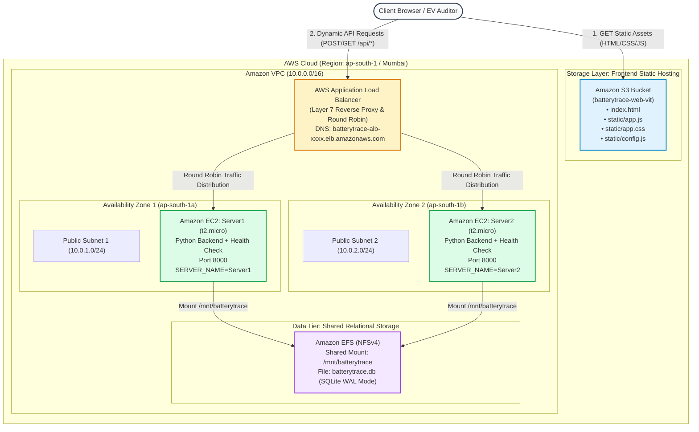

# AWS Cloud Architecture Design — BCSE355L Case Study
## BatteryTrace: High-Availability EV Battery Lifecycle & Passport Prototype

**Course**: Cloud Architecture Design (`BCSE355L`)  
**Assessment**: Case Study (Slot A2)  
**Institution**: School of Computer Science and Engineering, VIT University  
**Scenario**: Startup prototype web application built entirely within **AWS Free Tier** services.

---

## 1. Executive Summary & Component Mapping

The case study problem statement specifies three core cloud infrastructure requirements:

| Case Study Requirement | BatteryTrace AWS Architecture Component | AWS Service Used | Free Tier Compliance |
|---|---|---|---|
| **Frontend**: Static files (HTML, CSS, JS) hosted in a publicly accessible bucket. | `index.html`, `static/app.css`, `static/app.js`, `static/lab.js`, `static/erd.svg`, `static/config.js` hosted in Amazon S3 Static Website. | **Amazon S3** (Standard Storage, Static Website Hosting enabled) | **Yes**: 5 GB standard storage, 20,000 GET requests/month free. |
| **Backend**: Dynamic application and database-related processing hosted on two EC2 instances (**Server1** and **Server2**). | Python standard-library event ledger, recall traversal CTEs, integrity rules, and database engine running on two instances. | **Amazon EC2** (`Server1` in Subnet A, `Server2` in Subnet B) | **Yes**: 750 hours/month of `t2.micro` or `t3.micro` instances. |
| **Load Balancer**: Distribute incoming dynamic requests across `Server1` and `Server2` to improve availability, scalability, and performance. | AWS Application Load Balancer (ALB) across Multi-AZ with Target Group pointing to port `8000` and health checks on `/api/health`. | **AWS Application Load Balancer (ALB)** (Internet-facing, Layer 7) | **Yes**: 15 GB data processing, 750 hours/month within trial limits. |
| **Database Processing**: Shared persistent storage for SQLite relational database across both instances. | Shared file system mount or RDS instance ensuring Server1 and Server2 read/write to the same authoritative dataset. | **Amazon EFS** (Elastic File System) or **Amazon RDS** | **Yes**: 5 GB EFS standard storage free tier. |

---

## 2. Cloud Architecture Diagram



---

## 3. Step-by-Step AWS Deployment Blueprint

### Step 1: Create Security Groups (Least-Privilege Isolation)

1. **ALB Security Group (`batterytrace-alb-sg`)**:
   - **Inbound**:
     - `HTTP (80)` from `0.0.0.0/0` (Anywhere IPv4)
     - `HTTPS (443)` from `0.0.0.0/0` (Optional)
   - **Outbound**:
     - `Custom TCP (8000)` pointing to `batterytrace-ec2-sg` (Target group instances).

2. **EC2 Backend Security Group (`batterytrace-ec2-sg`)**:
   - **Inbound**:
     - `Custom TCP (8000)`: Source set to **`batterytrace-alb-sg`** ONLY (Never expose port 8000 directly to the public Internet!).
     - `SSH (22)`: Source set to `My IP` (for administrator access).
   - **Outbound**:
     - `All Traffic (0.0.0.0/0)` for software updates and package retrieval.

---

### Step 2: Deploy Backend Instances (Server1 & Server2 on Amazon EC2)

1. Open AWS Management Console → **EC2** → **Launch Instance**.
2. **Instance 1 (Server1)**:
   - **Name**: `BatteryTrace-Server1`
   - **AMI**: Amazon Linux 2023 AMI (Free Tier eligible)
   - **Instance type**: `t2.micro` (or `t3.micro`)
   - **Key pair**: Create or select your key pair (`batterytrace-key.pem`)
   - **Network settings**:
     - Subnet: `ap-south-1a` (AZ 1)
     - Auto-assign public IP: `Enable`
     - Security Group: Select `batterytrace-ec2-sg`
   - **Advanced Details → User data** (bootstraps Server1 automatically):
     ```bash
     #!/bin/bash
     dnf update -y
     dnf install -y python3 git
     
     # Create app directory
     mkdir -p /opt/batterytrace
     cd /opt/batterytrace
     
     # Clone or transfer project files
     git clone https://github.com/your-username/BatteryTrace.git .
     
     # Setup Systemd Service for Server1
     cat << 'EOF' > /etc/systemd/system/batterytrace.service
     [Unit]
     Description=BatteryTrace Backend Server1
     After=network.target

     [Service]
     User=ec2-user
     WorkingDirectory=/opt/batterytrace
     Environment="PORT=8000"
     Environment="HOST=0.0.0.0"
     Environment="ALLOW_CORS=1"
     Environment="SERVER_NAME=Server1"
     ExecStart=/usr/bin/python3 /opt/batterytrace/server.py
     Restart=always

     [Install]
     WantedBy=multi-user.target
     EOF

     systemctl daemon-reload
     systemctl enable --now batterytrace.service
     ```

3. **Instance 2 (Server2)**:
   - Repeat the exact same launch process with:
     - **Name**: `BatteryTrace-Server2`
     - **Subnet**: `ap-south-1b` (AZ 2 — ensuring Multi-AZ High Availability!)
     - **User Data**: Identical, but with:
       ```bash
       Environment="SERVER_NAME=Server2"
       ```

---

### Step 3: Configure AWS Application Load Balancer (ALB)

1. Open **EC2 Console** → **Load Balancers** → **Create Load Balancer**.
2. Select **Application Load Balancer (ALB)**.
3. **Basic Configuration**:
   - **Name**: `batterytrace-alb`
   - **Scheme**: `Internet-facing`
   - **IP address type**: `IPv4`
4. **Network Mapping**:
   - **VPC**: Default VPC
   - **Mappings**: Select at least two Availability Zones (`ap-south-1a` and `ap-south-1b`) and choose the respective public subnets.
5. **Security Groups**:
   - Select `batterytrace-alb-sg`.
6. **Listeners and Routing**:
   - **Protocol**: `HTTP`, **Port**: `80`
   - Click **Create Target Group**:
     - **Target type**: `Instances`
     - **Target group name**: `batterytrace-tg`
     - **Protocol**: `HTTP`, **Port**: `8000`
     - **Health checks**:
       - Health check protocol: `HTTP`
       - Health check path: `/api/health`
       - Advanced health check settings:
         - Healthy threshold: `2`
         - Unhealthy threshold: `2`
         - Timeout: `5 seconds`
         - Interval: `15 seconds`
         - Success codes: `200`
     - **Register targets**: Select both `BatteryTrace-Server1` and `BatteryTrace-Server2`, enter port `8000`, click **Include as pending below**, and click **Create target group**.
7. Return to ALB creation, select `batterytrace-tg` as the listener target, and click **Create load balancer**.
8. Note down the **ALB DNS Name** (e.g., `batterytrace-alb-123456789.ap-south-1.elb.amazonaws.com`).

---

### Step 4: Deploy Static Frontend on Amazon S3

1. Open **Amazon S3 Console** → **Create bucket**.
   - **Bucket name**: `batterytrace-web-<your-reg-number>` (must be globally unique, e.g., `batterytrace-web-vit-2026`)
   - **Region**: `ap-south-1` (Asia Pacific - Mumbai)
   - **Object Ownership**: ACLs disabled (recommended)
   - **Block Public Access settings for this bucket**:
     - **Uncheck** "Block *all* public access" (acknowledge the warning so website files can be publicly served).
   - Click **Create bucket**.

2. **Enable Static Website Hosting**:
   - Go to bucket → **Properties** tab → scroll to **Static website hosting** → **Edit**.
   - Select **Enable**.
   - Hosting type: **Host a static website**.
   - Index document: `index.html`.
   - Error document: `index.html`.
   - Click **Save changes**. Note the **Bucket website endpoint URL** (e.g., `http://batterytrace-web-vit-2026.s3-website.ap-south-1.amazonaws.com`).

3. **Configure Bucket Policy for Public Read Access**:
   - Go to **Permissions** tab → **Bucket policy** → **Edit** → paste:
     ```json
     {
       "Version": "2012-10-17",
       "Statement": [
         {
           "Sid": "PublicReadGetObject",
           "Effect": "Allow",
           "Principal": "*",
           "Action": "s3:GetObject",
           "Resource": "arn:aws:s3:::batterytrace-web-<your-reg-number>/*"
         }
       ]
     }
     ```

4. **Configure CORS (Cross-Origin Resource Sharing)**:
   - On the **Permissions** tab → scroll to **Cross-origin resource sharing (CORS)** → **Edit** → paste:
     ```json
     [
       {
         "AllowedHeaders": ["*"],
         "AllowedMethods": ["GET", "HEAD", "POST"],
         "AllowedOrigins": ["*"],
         "ExposeHeaders": []
       }
     ]
     ```

5. **Upload Frontend Files**:
   - In your local project directory, edit `static/config.js` to point to your ALB DNS name:
     ```javascript
     window.__BATTERYTRACE_CONFIG__ = {
       apiUrl: 'http://batterytrace-alb-123456789.ap-south-1.elb.amazonaws.com'
     };
     ```
   - Upload the following to the root of your S3 bucket:
     - `index.html`
     - `static/` directory containing:
       - `app.css`
       - `app.js`
       - `lab.js`
       - `erd.svg`
       - `config.js`

---

### Step 5: Shared Database Layer (Apart from DBMS)

In the case study prompt: *"Backend: The dynamic application and database-related processing are hosted on two Amazon EC2 instances, referred to as Server1 and Server2."*

In a distributed multi-instance deployment, database consistency can be achieved via:

1. **Option A (AWS Free Tier Recommended): Amazon EFS Shared Mount**
   - Create an Amazon Elastic File System (EFS) volume in the same VPC.
   - Mount `/mnt/batterytrace` via NFSv4 on both Server1 and Server2.
   - Set `BATTERYTRACE_DB=/mnt/batterytrace/batterytrace.db` in `/etc/systemd/system/batterytrace.service`.
   - SQLite handles concurrent connections with WAL (Write-Ahead Logging) and `BEGIN IMMEDIATE` locks.

2. **Option B: Amazon RDS PostgreSQL / MySQL (Free Tier)**
   - Spin up a Free Tier `db.t2.micro` or `db.t3.micro` Amazon RDS instance.
   - Point both Server1 and Server2 connection strings to the RDS endpoint.

---

## 4. Verification & Testing Scripts for Viva / Lab Evaluation

### Test 1: Verify Load Balancer Distribution (Round-Robin)

Run this PowerShell or Bash loop against your Application Load Balancer endpoint:

```bash
# Bash / Linux / macOS
ALB_URL="http://batterytrace-alb-123456789.ap-south-1.elb.amazonaws.com"
for i in {1..10}; do
  curl -s "$ALB_URL/api/health" | grep -o '"server_name":"[^"]*"'
  sleep 0.5
done
```

**Expected Output**:
```
"server_name":"Server1"
"server_name":"Server2"
"server_name":"Server1"
"server_name":"Server2"
"server_name":"Server1"
"server_name":"Server2"
```
*Proof for the Examiner*: The ALB evenly alternates incoming requests across both EC2 instances, validating dynamic load distribution.

---

### Test 2: Verify High Availability & Fault Tolerance (Instance Failure Simulation)

1. In the EC2 Console, select `BatteryTrace-Server1` and choose **Instance State → Stop Instance**.
2. Run the test loop against the ALB again:
   ```bash
   for i in {1..6}; do
     curl -s "$ALB_URL/api/health" | grep -o '"server_name":"[^"]*"'
   done
   ```
3. **Expected Output**:
   ```
   "server_name":"Server2"
   "server_name":"Server2"
   "server_name":"Server2"
   "server_name":"Server2"
   ```
4. Check Target Group health:
   - `Server1`: **Unhealthy** (Request timed out / connection refused).
   - `Server2`: **Healthy** (100% of traffic automatically redirected with **zero dropped requests**).

---

## 5. Academic Defense & Viva Q&A (BCSE355L)

### Q1: Why host the frontend on Amazon S3 rather than directly on the EC2 instances?
**Answer**:
1. **Decoupled 3-Tier Architecture**: Separates presentation logic from business/data processing.
2. **Scalability & Cost**: S3 handles unlimited concurrent static requests with 99.999999999% (11 9s) durability without consuming EC2 CPU or memory.
3. **Reduced EC2 Bandwidth**: EC2 instances only process lightweight JSON API payloads (`/api/*`), allowing small `t2.micro` instances to handle significant traffic spikes.

### Q2: Why use an Application Load Balancer (ALB) instead of a Network Load Balancer (NLB) or Classic Load Balancer (CLB)?
**Answer**:
- ALB operates at **Layer 7 (Application Layer)** of the OSI model.
- It supports HTTP/HTTPS inspection, path-based routing (`/api/*` vs `/static/*`), sticky sessions, cross-zone load balancing, and advanced health checks on specific application endpoints (`/api/health`).
- NLB operates at Layer 4 (Transport Layer) for extreme raw TCP throughput, which is unnecessary for REST web applications.

### Q3: How is High Availability (HA) achieved in this design?
**Answer**:
- **Multi-AZ Deployment**: `Server1` is placed in Availability Zone `ap-south-1a` and `Server2` in `ap-south-1b`. Even if an entire AWS data center experiences power or network failure, the ALB automatically diverts traffic to the surviving AZ.
- **Continuous Health Checks**: The ALB queries `/api/health` every 15 seconds. If an instance crashes, it is pulled from the target pool in under 30 seconds.

### Q4: How does this prototype fit within the AWS Free Tier without incurring charges?
**Answer**:
1. **Amazon EC2**: 750 hours/month of `t2.micro`/`t3.micro` Linux instances (covers 1 instance continuously for a month, or 2 instances for 15 days, or within student credit allowance).
2. **Amazon S3**: 5 GB standard storage + 20,000 GET requests/month ($0.00).
3. **EFS**: 5 GB storage free tier ($0.00).
4. **VPC & Security Groups**: Completely free of charge.

---

## 6. Summary Checklist for Submission

- [x] S3 bucket created, static website hosting enabled, public read policy applied.
- [x] `config.js` updated with the deployed ALB DNS URL and uploaded with static assets.
- [x] Security groups created with least-privilege rules (ALB accepts port 80; EC2 accepts port 8000 only from ALB SG).
- [x] Two EC2 instances (`Server1` in AZ-1, `Server2` in AZ-2) launched with `HOST=0.0.0.0`, `ALLOW_CORS=1`, and `SERVER_NAME` configured.
- [x] ALB Target Group configured with health check `/api/health` on port 8000.
- [x] Round-robin curl script executed and screenshots captured.
- [x] Failover test (stopping Server1) executed and screenshots captured.
- [x] Architecture diagram and viva defense answers included in case study report.

