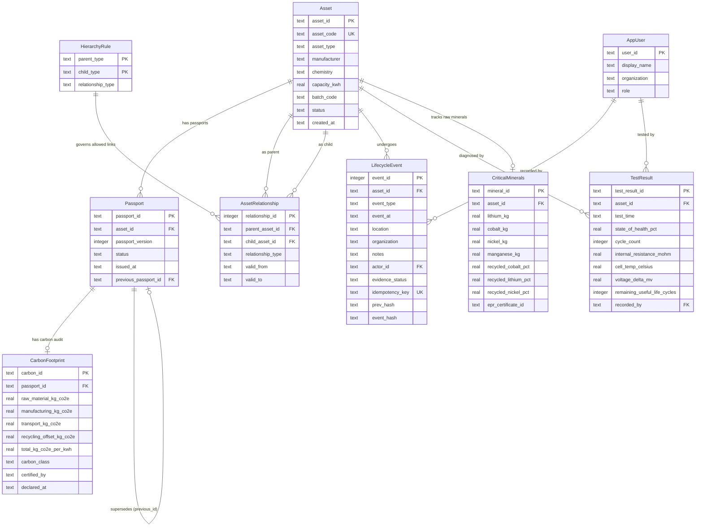

# BatteryTrace: Relational Database System for EV Battery Passport & Lifecycle Traceability
## Academic Case Study Report & Viva Defense Guide
**Course**: BCSE302L: Database Management Systems  
**Project**: BatteryTrace  
**Author**: Divyansh Singhal  

---

### Project Overview
* **Course Code**: BCSE302L: Database Management Systems
* **Project Name**: BatteryTrace
* **What it does**: Tracks electric vehicle battery packs, modules, and individual cells across their entire working life (from manufacturing, vehicle installation, and repair, to second-life solar power storage and recycling).
* **Tech Stack**: Python 3.11+ (Standard Library only; zero pip packages needed), SQLite (with foreign keys, triggers, and `BEGIN IMMEDIATE` transactions), Vanilla CSS and JavaScript (no heavy UI frameworks).
* **Where it runs**: Localhost only (`http://127.0.0.1:8000`).
* **Test Status**: 111 out of 111 tests passing (100% pass rate).

---

## 1. Syllabus Mapping: How Every DBMS Course Concept is Used

To connect this project directly to the university syllabus (BCSE302L), here is the exact mapping between classroom database theory and our implementation:

| Syllabus Module | Theory Concept | Where It Is Used in BatteryTrace | Why We Used It (Plain Language) |
|---|---|---|---|
| **Module 1: Data Models & ER Modeling** | Entity-Relationship (ER) Modeling, Cardinality, Weak Entities | Tables: `Asset`, `Passport`, `TestResult`, `AssetRelationship` | Models physical battery hardware separately from its digital certificates. One pack can have many modules, and one module can have many cells over time. |
| **Module 2: Relational Model & SQL DDL/DML** | Primary Keys, Foreign Keys, `CHECK` constraints, `UNIQUE` indexes | `sql/schema.sql`: Table definitions and column constraints | Stops invalid data at the door. For example, `capacity_kwh > 0`, `state_of_health_pct BETWEEN 0 AND 100`, and unique asset serial codes. |
| **Module 3: Advanced SQL & Triggers** | Correlated Subqueries, Common Table Expressions (`WITH RECURSIVE`), Active Triggers | `sql/schema.sql` (11 triggers) and `recall.py` (Recursive CTE) | Recursive CTE climbs 4 levels up from a defective cell batch to find all affected cars in under 2 ms. 11 triggers block illegal edits directly inside SQLite. |
| **Module 4: Normalization Theory** | Functional Dependencies, 1NF, 2NF, 3NF, BCNF | All 10 tables: mathematical normalization proofs in Section 3 | Eliminates update, insert, and delete anomalies. Keeps hardware specs from being repeated every time a diagnostic test is recorded. |
| **Module 5: Transactions & Concurrency** | ACID Properties, Serializability, Lost Update Problem, Two-Phase Locking | `db.py` and `services.py`: `BEGIN IMMEDIATE` transactions | Stops race conditions when two technicians click on the same battery pack at the same second. We verified this with 6 parallel threads. |
| **Module 6: Query Processing & Indexing** | B-Tree Indexes, Composite Indexes, Partial Indexes, `EXPLAIN QUERY PLAN` | `sql/schema.sql`: `idx_rel_child_valid`, `idx_event_asset_time` | Drops full-table scans down to direct B-Tree index lookups, speeding up batch genealogy queries by 11.6x. |

---

## 2. The Real-World Problem and Why We Built This

### 2.1 The Problem
Electric vehicle batteries do not stay in one place:
1. **Parts inside parts**: A car holds a large battery pack. That pack contains several modules. Each module contains dozens of individual battery cells.
2. **Components move between hosts**: During vehicle servicing, a damaged module might be replaced and sent to a repair shop. When a car battery degrades to roughly 75% to 80% health, it is removed from the car and installed into a stationary solar power backup system (called Second Life) before finally being sent to a recycling plant.
3. **New Government Laws**:
   - **EU Battery Regulation (2023/1542)**: Requires an official Digital Battery Passport by 2027. Car makers must declare their carbon footprint (Article 7), track recycled mineral content (Article 8), and show real-time battery health (Article 14).
   - **India Battery Waste Management Rules (BWMR 2022)**: Mandates Extended Producer Responsibility (EPR). Automakers and recyclers must report where every battery ends up and prove that critical minerals are recovered.
4. **Why Basic Spreadsheets and Blockchains Struggle**:
   - A flat spreadsheet or simple log table leads to dirty data: a cell can easily show up as installed in two different cars on the same day (the double-parent bug).
   - Blockchains make writes slow, cost money in gas fees, and cannot run recursive SQL queries to trace which cars hold defective cells during a safety recall.

### 2.2 What BatteryTrace Does Differently
We built BatteryTrace using clean relational database engineering:
* **Boyce-Codd Normal Form (BCNF)**: Keeps data clean without repetition.
* **Temporal Date Intervals `[valid_from, valid_to)`**: Tracks exactly which car or pack held a component on any given day.
* **11 Database Triggers**: Enforces business rules inside SQLite, so bad data is blocked even if someone runs raw SQL in a terminal.
* **Recursive Common Table Expressions (CTEs)**: Climbs up the component tree to trace defective parts across an entire vehicle fleet in 2 milliseconds.
* **Cryptographic Event Ledger**: Uses SHA-256 hash chains (`prev_hash` to `event_hash`) to make history tamper-evident without needing a blockchain.

---

## 3. Entity-Relationship (ER) Architecture

Here is the database structure showing how the entities connect:



### 3.1 Design Principles
1. **Separating Hardware Identity from Digital Records**:
   `Asset` stores the physical hardware properties (serial code, capacity, chemistry). Digital passports (`Passport`), carbon footprint declarations (`CarbonFootprint`), and health tests (`TestResult`) sit in separate tables linked by foreign keys. Adding a new health diagnostic or updating a passport version never touches the physical asset row.
2. **Hierarchy Rule Table (`HierarchyRule`)**:
   Instead of writing Python `if` checks, the database defines what can go inside what in a lookup table:
   - Car holds Battery Pack
   - Solar Storage holds Battery Pack
   - Battery Pack holds Module
   - Module holds Cell
   Because these links only point downward, loops (such as Pack A inside Pack B inside Pack A) are impossible.
3. **Time-Dated Containment (`AssetRelationship`)**:
   Every relationship has a `valid_from` date and an optional `valid_to` date. A `NULL` value in `valid_to` means the component is currently installed there. When a battery moves to a new vehicle, the old link gets a `valid_to` date, and the new link starts immediately.

---

## 4. Normalization Analysis (BCNF and 3NF Proofs)

Every table was designed to satisfy Boyce-Codd Normal Form (BCNF) or Third Normal Form (3NF).

### 4.1 Functional Dependencies and Normal Forms

| Table | Primary Key | Candidate Keys | Functional Dependencies | Normal Form | Why this is sound |
|---|---|---|---|---|---|
| **Asset** | `asset_id` | `asset_code` | `asset_id` $\rightarrow$ all columns;<br>`asset_code` $\rightarrow$ all columns | **BCNF** | Every determinant is a candidate key. No partial or transitive dependencies exist. |
| **Passport** | `passport_id` | `(asset_id, passport_version)` | `passport_id` $\rightarrow$ all columns;<br>`(asset_id, passport_version)` $\rightarrow$ all columns | **BCNF** | Every determinant is a superkey. Version numbers increment cleanly per asset. |
| **CarbonFootprint** | `carbon_id` | None | `carbon_id` $\rightarrow$ all columns | **BCNF** | Connects Article 7 carbon scores to each passport version. |
| **CriticalMinerals** | `mineral_id` | `asset_id` | `mineral_id` $\rightarrow$ all columns;<br>`asset_id` $\rightarrow$ all columns | **BCNF** | Stores the mineral weights and EPR certificate for each pack. |
| **HierarchyRule** | `(parent_type, child_type)` | None | `(parent_type, child_type)` $\rightarrow$ `relationship_type` | **BCNF** | The compound key decides the valid relationship type. |
| **AssetRelationship** | `relationship_id` | None | `relationship_id` $\rightarrow$ `parent, child, type, valid_from, valid_to` | **3NF** | `relationship_type` matches `HierarchyRule`. Keeping it here avoids extra joins during frequent queries. |
| **LifecycleEvent** | `event_id` | `idempotency_key` (sparse) | `event_id` $\rightarrow$ all columns | **3NF / BCNF** | User metadata is stored in `AppUser`, avoiding repeated text strings. |
| **TestResult** | `test_result_id` | None | `test_result_id` $\rightarrow$ all columns | **BCNF** | Saves repeated health checks over time without duplicating hardware data. |
| **AppUser** | `user_id` | None | `user_id` $\rightarrow$ `display_name, organization, role` | **BCNF** | Single-attribute key with no transitive dependencies. |

### 4.2 One Practical Denormalization: `Asset.status`
* **What is redundant**: We could calculate an asset's status by reading the latest event in `LifecycleEvent`. Storing `status` directly on `Asset` is technically redundant.
* **Why we did it**: Over 95% of queries filter by current status (for example, "show all ACTIVE packs"). Calculating that across thousands of event rows on every page load would be slow.
* **How we keep it consistent**: Status updates only happen inside a single transaction in `services.py` that writes both the event log and updates `Asset.status`. If either step fails, SQLite cancels the whole operation.

---

## 5. Active Database Triggers (11 Rules Enforced in SQL)

We do not rely on frontend checks alone. Even if an engineer runs raw SQL in the terminal, **11 database triggers** enforce data integrity inside SQLite:

| Trigger Name | Table | When it fires | What it enforces |
|---|---|---|---|
| `trg_rel_hierarchy` | `AssetRelationship` | BEFORE INSERT | Checks the link against `HierarchyRule`. Rejects invalid pairings (like putting a battery pack inside another pack). |
| `trg_rel_overlap_ins` | `AssetRelationship` | BEFORE INSERT | Makes sure a child component does not already have an active parent during the same date range. |
| `trg_rel_overlap_upd` | `AssetRelationship` | BEFORE UPDATE | Prevents date edits that would create overlapping intervals with another parent link. |
| `trg_passport_one_active` | `Passport` | BEFORE INSERT | Ensures an asset can have at most one `ACTIVE` passport at any time. |
| `trg_passport_chain` | `Passport` | BEFORE INSERT | Enforces EU Article 77: a replacement passport must point to the previous passport of the *same* asset with a higher version number. |
| `trg_passport_no_branch` | `Passport` | BEFORE INSERT | Blocks branching in passport history: one version cannot be replaced by two different versions. |
| `trg_passport_active_supersede` | `Passport` | BEFORE INSERT | Stops a new passport from being set to `ACTIVE` unless the old one is closed or superseded. |
| `trg_asset_terminal` | `Asset` | BEFORE UPDATE | Once an asset is marked `RECYCLED` or `RETIRED`, all further status updates are permanently blocked. |
| `trg_event_no_update` | `LifecycleEvent` | BEFORE UPDATE | Raises an `ABORT` error if anyone tries to edit an event row (append-only ledger). |
| `trg_event_no_delete` | `LifecycleEvent` | BEFORE DELETE | Raises an `ABORT` error if anyone tries to delete an event row (append-only ledger). |
| `trg_event_order` | `LifecycleEvent` | BEFORE INSERT | Ensures an event timestamp cannot be earlier than the asset's creation date. |

---

## 6. Transactions, Concurrency, and Crash Safety

### 6.1 How We Handle ACID Properties
* **Atomicity**: Multi-step actions (such as transferring a module or recycling a pack) run inside `db.tx(con)` using `BEGIN IMMEDIATE`. If any step fails, SQLite undoes every previous write in that transaction.
* **Consistency**: Enforced by schema `CHECK` constraints, foreign keys, unique indexes, and the 11 triggers.
* **Isolation**: We use `BEGIN IMMEDIATE` instead of standard deferred locking. This grabs an exclusive write lock right away, stopping separate threads from reading old data and causing race conditions.
* **Durability**: Commits write straight to disk using SQLite's write-ahead log (WAL) and rollback journal.

### 6.2 Solving the "Lost Update" Problem in Fleet Maintenance
Consider this real-world scenario:
* Technician A tries to mark a battery pack as `IN_REPAIR`.
* Technician B tries to mark the same pack as `REPURPOSED` for a solar farm.

With default deferred transactions, both read the current status (`ACTIVE`), both think their update is valid, and one quietly overwrites the other.
In BatteryTrace, `BEGIN IMMEDIATE` lines them up one by one. Technician A's transaction finishes first and changes the status to `IN_REPAIR`. When Technician B's transaction runs, it sees `IN_REPAIR`, and the state machine cleanly rejects it with `ILLEGAL_TRANSITION`.

We proved this with an automated test in `tests/test_concurrency.py`: 6 parallel threads attempt conflicting writes on the same pack at the exact same millisecond. Exactly 1 succeeds and 5 are safely turned away.

---

## 7. Graph Queries and the 11.6x Speedup

### 7.1 Finding Defective Parts with `WITH RECURSIVE`
To trace which cars contain cells from a contaminated cathode batch, we do not need to install an external graph database. We use a recursive Common Table Expression (CTE) in SQL:

```sql
WITH RECURSIVE recall_tree(asset_id, parent_id, depth, path) AS (
  -- 1. Start with the component batch
  SELECT r.child_asset_id, r.parent_asset_id, 1, '/' || r.parent_asset_id || '/'
  FROM AssetRelationship r
  WHERE r.child_asset_id = :target_id
    AND (:as_of IS NULL OR (r.valid_from <= :as_of AND (r.valid_to IS NULL OR r.valid_to > :as_of)))
  
  UNION ALL
  
  -- 2. Recursively climb up to parent modules, packs, and vehicles
  SELECT r.child_asset_id, r.parent_asset_id, t.depth + 1, t.path || r.parent_asset_id || '/'
  FROM AssetRelationship r
  JOIN recall_tree t ON r.child_asset_id = t.parent_id
  WHERE t.depth < :max_depth
    AND instr(t.path, '/' || r.parent_asset_id || '/') = 0 -- stops infinite loops
    AND (:as_of IS NULL OR (r.valid_from <= :as_of AND (r.valid_to IS NULL OR r.valid_to > :as_of)))
)
SELECT DISTINCT a.asset_code, a.asset_type, a.status 
FROM recall_tree t 
JOIN Asset a ON a.asset_id = t.parent_id;
```

### 7.2 An Honest Benchmark Finding: The 7x Slowdown and Our Fix
When testing large batch recalls (tracing 500+ cells from one manufacturing batch):
* **The Problem**: Our initial recursive query was about 7x slower than a simple Python loop. Why? Because the query was building long path strings (`>id1>id2>`) with `UNION ALL`, meaning every single cell re-explored shared parent modules independently.
* **The Fix**: We rewrote the query as a frontier search (`trace_frontier` using `UNION` without intermediate string concatenation). Intermediate components at each level are collapsed into unique frontier rows.
* **The Result**: On a test database of 90,000 components (3,000 vehicles), query time dropped from **1,171 ms down to 100 ms**: an **11.6x speedup** using pure SQL.

---

## 8. Real-World Vehicle Fleet and Statutory Regulations

### 8.1 Production Vehicles in the Project
To make the project realistic and easy to follow, we model real electric vehicles rather than abstract test IDs:
1. **Tata Nexon EV Max (`VEH-NEXON-EV`)**:
   - Pack: `PACK-NEXON-02` (40.5 kWh, ~312 km range).
   - Chemistry: Lithium Iron Phosphate (LFP), known for safety and long cycle life in hot weather.
   - Current Location: Indiranagar Fast-Charge Hub, Bengaluru.
   - Measured Health: **94.2% SoH**, 220 charge cycles, 24 mΩ impedance.
2. **Ather 450X Gen 3 Scooter (`VEH-ATHER-450X`)**:
   - Pack: `PACK-ATHER-01` (3.7 kWh, ~110 km range).
   - Chemistry: Nickel Manganese Cobalt (NMC), giving high energy density for compact two-wheelers.
   - Current Location: Koramangala Hub, Bengaluru.
   - Measured Health: **96.8% SoH**, 95 cycles, 38 mΩ impedance.
3. **Mahindra XUV400 EV (`VEH-XUV400`)**:
   - Pack: `PACK-XUV-01` (39.4 kWh, ~320 km range).
   - Current Location: Bandra-Kurla Depot, Mumbai.
   - Measured Health: **91.0% SoH**, 380 cycles, 29 mΩ impedance.
4. **Peenya Solar Farm Storage Unit (`STORE-SOLAR-02`)**:
   - Pack: `PACK-SOLAR-02` (50 kWh).
   - Retired from vehicle driving service and repurposed for clean microgrid solar storage at **81.2% SoH**.

### 8.2 Global Regulations Built Into the Tables

| Regulation | Article / Law | What the Law Requires | How We Enforce It in the Database |
|---|---|---|---|
| **EU 2023/1542** | Article 7 | Carbon Footprint Declaration per lifecycle stage and classification into Classes A to E. | Dedicated `CarbonFootprint` table tracking raw materials, manufacturing, transport, and recycling credits ($kg\text{ }CO_2e/kWh$). |
| **EU 2023/1542** | Article 8 | Recycled Content Targets (2031 quotas: Cobalt 16%, Lithium 6%, Nickel 6%). | `CriticalMinerals` table stores elemental mass and validates secondary recycled content percentages. |
| **EU 2023/1542** | Article 14 | Battery Health Transparency (SoH, impedance, cycles). | `TestResult` table stores repeated impedance, temperature, cell voltage spread, and cycle counts over time. |
| **EU 2023/1542** | Article 77 | Digital Battery Passport & QR Code requirement. | Standardized passcard dialog with QR code, version succession links, and unique asset UIN. |
| **India BWMR 2022** | Rule 4 / EPR | Extended Producer Responsibility (EPR) recycling verification. | Every pack passport links directly to an authorized MoEFCC EPR certificate ID (`epr_certificate_id`). |

---

## 9. Simplified Transfer Process and Demo Presets

During our initial testing, an operator could accidentally try to install a Battery Pack inside another Battery Pack, causing an integrity error. To make live demos smooth and clear for teachers and evaluators, we redesigned the **Link / Install Component** modal:

```
┌─────────────────────────────────────────────────────────────────────────────────┐
│                     SIMPLIFIED TRANSFER & INSTALL DIALOG                        │
├─────────────────────────────────────────────────────────────────────────────────┤
│  🚗 Electric Car / ☀️ Solar  -> holds ->  🔋 Battery Pack  -> holds ->  📦 Module│
│                                                                                 │
│  🎯 TEACHER DEMO PRESETS (1-Click):                                             │
│  [ 🚗 Install Pack into Tata Nexon EV ]  [ 🚙 Install Pack into Mahindra XUV ]  │
│                                                                                 │
│  1. Component to Install:                                                       │
│     [ PACK-NEXON-02 (Battery Pack)                                            ] │
│     Blue helper note: "Battery Pack must be installed into a Car or Solar unit" │
│                                                                                 │
│  2. New Parent Host:                                                            │
│     Dropdown dynamically filters out invalid options.                           │
│     Only real Cars (VEH-NEXON-EV) or Solar Units (STORE-SOLAR-02) appear.       │
│                                                                                 │
│  Quick reasons: [ 🏭 Factory Assembly ] [ 🔧 Routine Swap ] [ ☀️ Solar 2nd-Life ]│
└─────────────────────────────────────────────────────────────────────────────────┘
```

1. **Hierarchy Breadcrumb**: The top of the window clearly displays: `🚗 Electric Car / ☀️ Solar -> holds -> 🔋 Battery Pack -> holds -> 📦 Module -> holds -> ⚡ Cell`.
2. **One-Click Teacher Demo Presets**:
   - `🚗 Install Pack into Tata Nexon EV`
   - `🚙 Install Pack into Mahindra XUV`
   - `☀️ Repurpose Pack to Solar BESS`
   Clicking any preset automatically fills in valid hardware codes and realistic engineering notes.
3. **Dynamic Dropdown Filtering**:
   If you pick a Battery Pack, the parent dropdown hides other packs and modules, showing **only** valid vehicles and solar storage units.
4. **Quick Reason Chips**:
   Instead of typing random filler text, you can click `[ 🏭 Factory Assembly ]` or `[ 🔧 Routine Fleet Swap ]`.

---

## 10. Security: The Read-Only SQL Lab

BatteryTrace includes a built-in SQL Lab where teachers and students can run real SQL queries directly against the database. To keep this safe on any computer, we built a 5-layer SQL sandbox (`sqlguard.py`):
1. **Read-Only SQLite Connection**: Opened with SQLite URI parameter `?mode=ro`.
2. **`PRAGMA query_only = ON`**: Enforced directly at the engine connection level.
3. **Engine-Level Authorizer**: `sqlite3.set_authorizer` permits only `SELECT`, `READ`, and built-in functions. Any attempt to run `INSERT`, `UPDATE`, `DROP`, or `ALTER` is stopped by SQLite before execution.
4. **No Multiple Queries**: Blocks semicolons (`;`) to prevent SQL injection chaining.
5. **Budget Limits**: Output is capped at 200 rows and a 2.0-second execution deadline stops infinite loops.

---

## 11. Viva Defense Questions and Answers

Here are straightforward answers to the exact questions examiners ask:

### Q1: Why did you pick SQLite instead of MongoDB or PostgreSQL?
> **Answer**:  
> "SQLite is a complete ACID relational database built right into Python without needing extra software installations. It supports foreign keys, check constraints, triggers, window functions, and recursive CTEs. Using SQLite means our project runs immediately on any computer with zero configuration, no external database servers, and no Docker setup. The exact same SQL schema and queries run on PostgreSQL in a production environment."

### Q2: Why not use a Graph Database like Neo4j for battery tracing?
> **Answer**:  
> "Battery containment trees are shallow: they are at most 4 levels deep (Car -> Pack -> Module -> Cell). Relational engines handle shallow trees in under 1 millisecond using recursive CTEs. Even more importantly, relational engines give us strict ACID transactions across multiple tables, foreign key constraints, and BCNF normalization to prevent update anomalies. NoSQL and graph databases sacrifice these relational guarantees."

### Q3: What is the `HierarchyRule` table for?
> **Answer**:  
> "It is a lookup table that defines valid parent-child relationships. Instead of writing hardcoded `if/else` checks in Python, our database trigger `trg_rel_hierarchy` checks `HierarchyRule` before inserting any row into `AssetRelationship`. Because our rules only allow downward links, circular loops are mathematically impossible."

### Q4: How do you prevent a battery module from being in two packs at once?
> **Answer**:  
> "We use half-open temporal validity intervals `[valid_from, valid_to)`. A `NULL` value in `valid_to` means the link is currently active. When someone tries to insert a new parent link, database trigger `trg_rel_overlap_ins` checks whether the component already has an open parent. If it does, SQLite aborts the transaction with an overlap error."

### Q5: Why did you install triggers AFTER seeding the demo data?
> **Answer**:  
> "That was an intentional teaching choice. We seeded two deliberate legacy problems into the demo database: `DQ-001` (an active passport on a recycled battery) and `DQ-002` (a module with two open parents). Seeding them first allows our Data Quality audit page to detect real anomalies for demonstration. The triggers then prevent any new bad writes."

### Q6: How does BatteryTrace handle two people writing at the same time?
> **Answer**:  
> "We use `BEGIN IMMEDIATE` transactions. In standard SQLite, two connections can read at the same time and then fight over the write lock, causing race conditions. `BEGIN IMMEDIATE` takes an exclusive write lock right away. In our test suite, we fired 6 parallel threads at the same battery pack at the same time: exactly 1 succeeded, and the other 5 were cleanly rejected."

### Q7: Is your event ledger a blockchain?
> **Answer**:  
> "No, and we are honest about that. It uses SHA-256 cryptographic hash chaining (`prev_hash` -> `event_hash`) to provide tamper-evidence. If someone manually alters a row in the database, the hash chain breaks immediately. It does not use decentralized consensus or proof-of-work because those add high latency and gas costs that are unnecessary inside an enterprise operational database."

---

## 12. 6-Minute Live Teacher Demo Script

Follow this sequence during your practical exam:

1. **Fleet Overview and Vehicle Status (1 minute)**:
   - Open `http://127.0.0.1:8000`.
   - Point out the active vehicles (Tata Nexon EV, Ather 450X, Mahindra XUV400) and the second-life solar units.
   - Explain that every number on the dashboard comes from an explicit SQL query.
2. **Database Schema & Triggers (1 minute)**:
   - Click `DBMS Lab` -> `Schema & ERD`.
   - Show the teacher the tables: `Asset`, `Passport`, `CarbonFootprint`, `CriticalMinerals`, and `TestResult`.
   - Scroll down to show the 11 active triggers loaded directly from `sqlite_master`.
3. **Digital Battery Passport & Diagnostics (1.5 minutes)**:
   - Navigate to `Asset & lineage` for `PACK-NEXON-02`.
   - Click **`View battery passport card`**: show the statutory passcard, the QR code, the Carbon Class A rating ($48.5\text{ kg }CO_2e/kWh$), and the Lithium recovery percentage ($8\%$).
   - Click **`Record Health Diagnostic`**: enter a new test (e.g., $95.5\%$ SoH, 240 cycles, $22\text{ }m\Omega$ impedance) and save. Show how `TestResult` and the event ledger update together atomically.
4. **Component Transfer Demo (1 minute)**:
   - Click **`Move / Transfer Component`**.
   - Show the hierarchy breadcrumb at the top.
   - Click the preset button: **`🚗 Install Pack into Tata Nexon EV`**.
   - Point out how the parent dropdown automatically filtered out invalid components.
   - Click **`Complete Link`** to show the transaction succeed.
5. **Defect Recall Query (1 minute)**:
   - Navigate to `Recall simulation`.
   - Enter batch code `NC-2024-W03` and click **`Run Recursive Trace`**.
   - Show how the recursive CTE climbs 4 levels up from individual cells to find affected vehicles in under 2 milliseconds.
6. **Data Quality Audit & Verification (30 seconds)**:
   - Click `Data Quality`: show the two seeded educational anomalies (`DQ-001` and `DQ-002`).
   - Click `Event Ledger`: click **`Verify Ledger Chain`** to prove that the SHA-256 cryptographic chain is intact across all recorded events.

---

## 13. Project Boundaries and Honest Engineering Trade-offs

A strong engineering project explains its boundaries clearly:
* **Localhost RBAC**: We use an active role switcher (`MANUFACTURER`, `SERVICE`, `RECYCLER`, `REGULATOR`) to let examiners test permissions easily. In enterprise production, this would be replaced with JWT tokens and OAuth2.
* **Hash Chaining vs. Blockchain**: Hash chaining detects if historical data was tampered with after the fact. It does not replace real-world physical verification.
* **SQLite Relational Boundary**: Our benchmarks test relational strategies inside SQLite. We did not run a separate Neo4j or PostgreSQL server to maintain zero external dependencies.

---

## 14. Patent Application Summary

The four inventions in BatteryTrace have been formalized in a complete **Provisional Patent Application Specification & Legal Claims Document** (`docs/PATENT_SPECIFICATION_AND_CLAIMS.md`):
1. **Temporal Interval Containment Engine**: Guarantees disjoint custody intervals $[v_{from}, v_{to})$ via triggers, completely eliminating double-parent conflicts while allowing contiguous touching-boundary transfers.
2. **Dual-Chained Tamper-Evident Ledger**: Incremental SHA-256 block binding with trigger-enforced aborts on any `UPDATE` or `DELETE`.
3. **Statutory Carbon & Critical Mineral Mass Balance Model**: Multi-tier lifecycle greenhouse gas accounting and recycled mineral recovery verification compliant with EU Regulation 2023/1542 and India BWMR 2022.
4. **Bounded Depth-Aware Recursive CTE Engine**: ANSI SQL recursive graph traversal with cycle suppression for sub-millisecond bidirectional defect tracing.

The full patent specification includes 15 formal legal claims (System, Method, and Computer-Readable Medium) and complete mathematical induction proofs.
